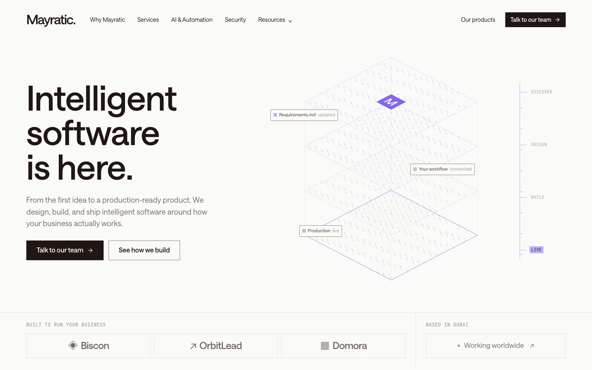

<div align="center">

# Mayratic

**Intelligent software, built around your business.**

The marketing website for [Mayratic](https://www.mayratic.com), a Dubai-based studio that designs and builds web platforms, mobile apps and AI automation.

[](https://github.com/davidpalmer257/mayratic/actions/workflows/ci.yml)




</div>

## Overview

A fast, fully static site: a homepage plus ten content pages (services, AI & automation, security, products, process, project assessment, free tools, contact and about). It exports to plain HTML, CSS and JS, so it can be hosted anywhere without a Node.js server.

### Highlights

- **Interactive hero.** A canvas-rendered, four-layer "context stack" (Discover, Design, Build, Live) driven by GSAP, with a clickable phase control.
- **Scroll-driven motion.** GSAP and ScrollTrigger reveal sections, draw SVG curves and stage the build-chat sequence.
- **Project assessment.** A five-step questionnaire that suggests a starting point and prefills the contact form with the answers.
- **Booking flow.** The contact form hands name, email and project context to a prefilled Calendly booking.
- **Product showcase.** Biscon, OrbitLead and Domora, with an illustrative product-console demo.
- **Accessible by default.** Skip link, semantic landmarks, keyboard-friendly dialogs, `aria` labelling and full `prefers-reduced-motion` support.
- **SEO ready.** Per-page metadata, Open Graph tags, `sitemap.xml` and `robots.txt` generated at build time.

## Tech stack

| Area | Choice |
| --- | --- |
| Framework | Next.js 16 (App Router, static export) |
| UI | React 19, TypeScript |
| Styling | Tailwind CSS 4 plus hand-written component CSS |
| Animation | GSAP 3 with ScrollTrigger and the Canvas 2D API |
| Typography | Saans and JetBrains Mono, self-hosted |

## Getting started

Requires **Node.js 20 or newer** (CI runs Node 22).

```sh
git clone https://github.com/davidpalmer257/mayratic.git
cd mayratic
npm install
npm run dev
```

Open the address printed in the terminal (the dev server binds to `127.0.0.1`).

### Scripts

| Command | What it does |
| --- | --- |
| `npm run dev` | Start the development server |
| `npm run typecheck` | Type-check the project with `tsc --noEmit` |
| `npm run build` | Create the static export in `out/` |
| `npm run start` | Serve a production build locally |

## Configuration

| Variable | Purpose | Default |
| --- | --- | --- |
| `NEXT_PUBLIC_SITE_URL` | Production origin used for metadata, the sitemap and `robots.txt` | https://www.mayratic.com |

Set it when building for the live domain:

```sh
NEXT_PUBLIC_SITE_URL=https://www.mayratic.com npm run build
```

## Project structure

```
src/
├── app/                  Routes, layout, metadata, sitemap and robots
│   └── [slug]/           Statically generated content pages
├── components/
│   ├── home.tsx          Homepage composition and scroll reveals
│   ├── hero-stack.tsx    Animated canvas layers and build-phase control
│   ├── site-shell.tsx    Navigation, contact dialog, booking form, footer, cookies
│   ├── content-page.tsx  The ten linked content pages
│   ├── assessment.tsx    Five-step project assessment
│   ├── products.tsx      Product carousel
│   └── product-demo.tsx  Illustrative product-console demo
├── content/
│   ├── pages.ts          Services, process steps, FAQs and page metadata
│   └── home-sections.json  Section markup and SVG illustrations (trusted, local content)
├── styles/
│   ├── design-system.css     Layout, design tokens and typography
│   └── globals.css       Components, navigation, responsive layout, reduced motion
└── lib/site.ts           Site-wide constants
public/                   Fonts, images and static assets
```

## Deployment

`npm run build` writes a self-contained site to `out/`. Routes use trailing slashes (`/services/`), and assets are referenced from the site root, so deploy it at the root of a domain or subdomain.

- **Vercel / Netlify / Cloudflare Pages:** import the repository. Build command `npm run build`, output directory `out`.
- **Any static host (Apache, Nginx, cPanel, DirectAdmin):** upload the contents of `out/` to the web root.

## Quality checks

GitHub Actions runs the type-check and a production build on every push and pull request. See [.github/workflows/ci.yml](.github/workflows/ci.yml).

## Notes

- `src/content/home-sections.json` is rendered as trusted HTML. Do not populate it with untrusted input.
- Booking, WhatsApp, product links, free tools and legal pages point to Mayratic's existing public destinations. The site includes no email service or database.
- If the Calendly event is edited, confirm its first custom question is still the project-context question: the form fills it through the `a1` parameter.
- The product console is an illustrative overview, not a live product.

## License

Copyright © 2026 Mayratic. All rights reserved. No licence is granted to copy, modify or redistribute this code without written permission.
